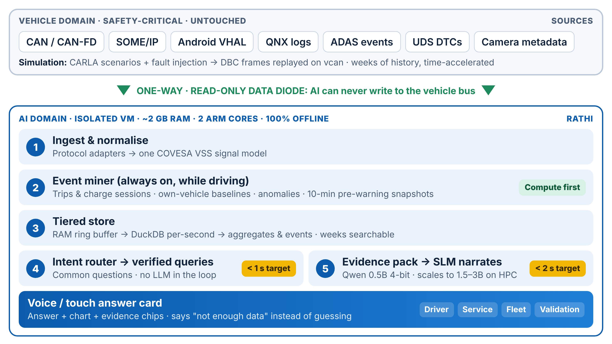

# Rathi

**The car that explains itself. Offline · under 2 s · 2 GB RAM.**

Rathi is an on-device vehicle assistant for software-defined vehicles. Ask it a question in plain English or Hindi, such as *"Why has my driving range reduced over the last two weeks?"*, and it answers from the car's own data, with a chart, the evidence it used and how confident it is. It works for any powertrain: electric, petrol, diesel or hybrid.

**Live web preview:** https://indhuja-elumalai.github.io/rathi/

Built for Tata Elxsi Teliport Season 4, Case Study 5 (VehicleGPT).



## The idea: compute first, talk later

A language model that reads raw vehicle data cannot answer in under 2 seconds on 2 GB of RAM and two ARM cores. Rathi does the analysis continuously while the car drives, so when you ask, the answer is already computed. A small language model only explains verified evidence. **Accuracy comes from the analytics, not model size.**

1. **Collect:** CAN/CAN-FD, SOME/IP, Android VHAL, QNX logs, ADAS events and diagnostic codes, normalised to the COVESA VSS signal model through a one-way, read-only path. The AI can never write to the vehicle bus.
2. **Pre-compute:** an always-on event miner splits driving into trips, learns this vehicle's own normal behaviour, flags anomalies and keeps a snapshot before every warning.
3. **Retrieve:** an intent router sends common questions to verified queries, with no language model in the loop.
4. **Explain:** for "why" questions, a small model narrates a compact evidence pack.
5. **Never guess:** when data is missing, Rathi says so instead of inventing an answer.

## What the web preview shows

- **Questions from the problem statement:** range drop, the largest efficiency drop, ADAS disengagements, what happened before a warning, city vs highway consumption.
- **Explain this warning:** ranks which signals drifted furthest from this car's own baseline before the warning, and when the drift started.
- **Any powertrain:** switch between the Electric and Petrol profiles. The same pipeline handles battery temperature or engine coolant temperature, Wh/km or L/100 km.
- **English and Hindi questions**, e.g. *"range kyun kam ho gayi?"*
- **Self-scoring benchmark:** faults are injected into the simulation, so the correct answer to every question is known. The Benchmark tab checks each answer against that ground truth.

## Measured results (web preview)

| Check | Result |
|---|---|
| Benchmark questions | 16 per powertrain, including Hindi and unanswerable questions |
| Correct answers | 9,598 / 9,600 (99.98%) across 300 random datasets × 2 powertrains |
| Answer time in the browser | well under 5 ms per question |

Run it yourself:

```bash
node tests/bench.mjs 300
```

The benchmark also runs on every push in GitHub Actions before the site deploys.

## Web preview vs on-device build

| Part | Web preview (now) | On-device build (in progress) |
|---|---|---|
| Data | Seeded simulation in the browser | CARLA scenarios with fault injection, replayed on virtual CAN |
| Storage | In memory | RAM ring buffer → DuckDB → aggregates, weeks of history |
| Router and analytics | JavaScript | Python service |
| Narration | Templates over the evidence pack | Qwen 0.5B, 4-bit, via llama.cpp |
| Hardware | Your browser | Raspberry Pi 5 or ARM VM, 2 GB RAM, 2 cores |

Design targets for the on-device build, to be measured: about 1.3 GB peak RAM, under 1 s for common questions, under 2 s for "why" answers.

## Run locally

No build step and no dependencies:

```bash
python3 -m http.server 8000
# open http://localhost:8000
```

## Limitations

- All data in the preview is simulated. Real vehicle traces will be noisier.
- Narration in the preview uses templates; the small language model runs in the on-device build.
- Some VSS paths marked "(extension)" or "(derived)" are not in the standard catalogue and would be added as custom signals.

## License

[MIT](LICENSE)
